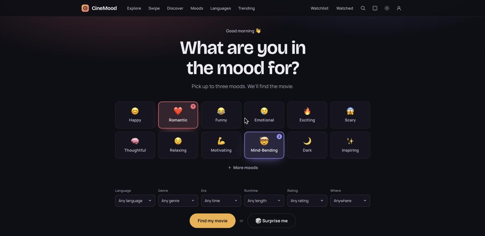
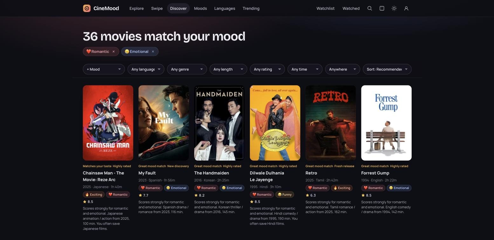
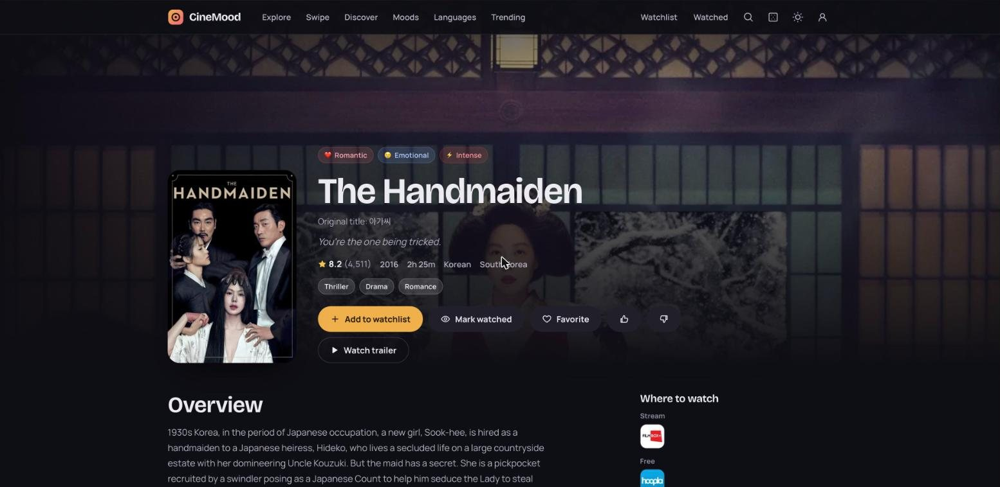
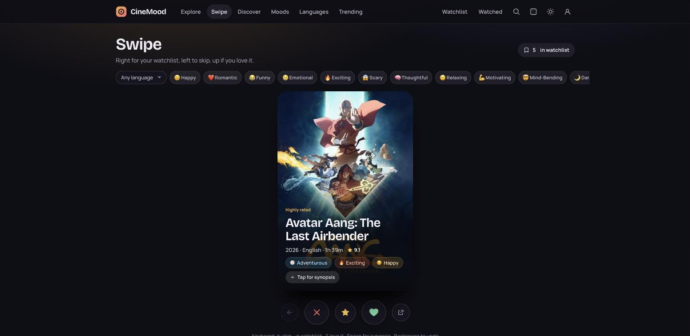
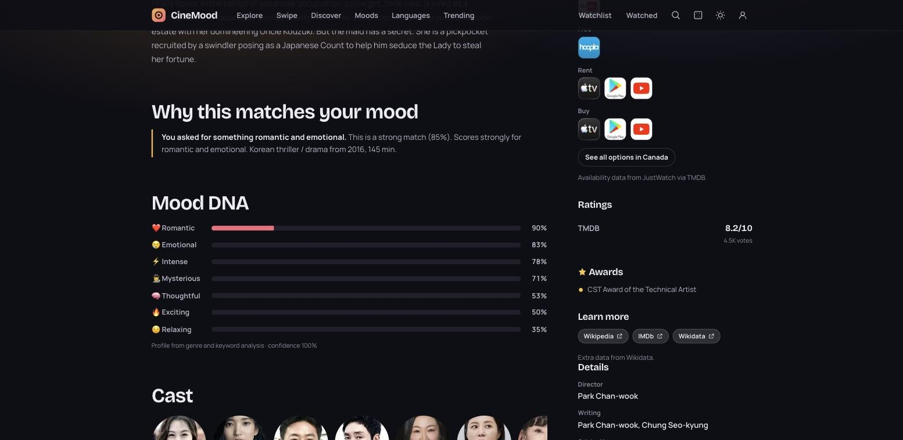
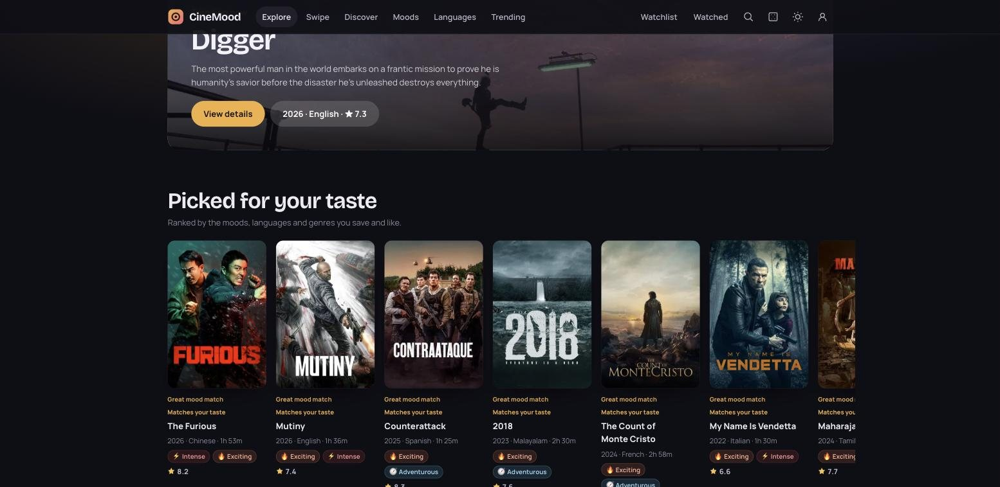
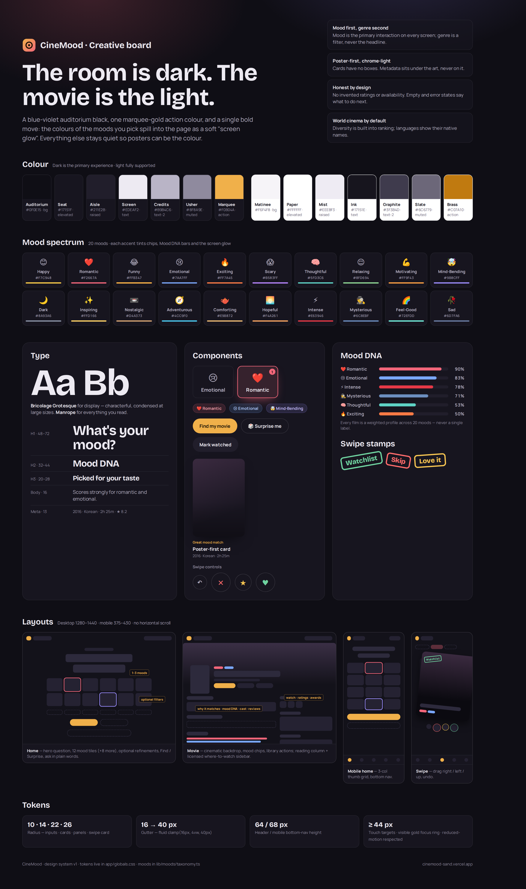

# 🎬 CineMood

> **Tell us how you feel. We'll find the movie.**

CineMood is a mood-first, global movie discovery platform. Pick up to three moods (or just describe what you want), optionally narrow by language, genre, era, runtime, rating or where to watch, and get a ranked, *diverse* list of films from every country — each with an explanation of why it fits.

Built with **Next.js 16 (App Router) · React 19 · TypeScript · Supabase (Postgres + Auth + RLS) · TMDB · OMDb · Trakt · Wikidata · Ollama (local AI)**.

---

**Live:** https://cinemood-sand.vercel.app

<p align="center">
  
</p>

## Screenshots

| Discover — ranked by mood | Movie — Mood DNA, ratings, where to watch |
|---|---|
|  |  |
| **Swipe — Tinder-style picker** | **Why it matches + Mood DNA + awards** |
|  |  |
| **Explore — picked for your taste** | |
|  | |

## Creative board

> *The room is dark. The movie is the light.* — a blue-violet auditorium black, one marquee-gold action colour, and a single bold move: the colours of the moods you pick spill into the page as a soft "screen glow".

<p align="center">
  
</p>

Source: [`docs/design/creative-board.html`](docs/design/creative-board.html) (open in a browser to edit). Tokens live in `app/globals.css`; mood colours in `lib/moods/taxonomy.ts`.

## UI layout

```text
DESKTOP ─ Home                                     DESKTOP ─ Movie
┌──────────────────────────────────────────┐       ┌──────────────────────────────────────────┐
│ ◉ CineMood  Explore Swipe Discover …  ⌕ ☾ │       │ ◉ CineMood  …                         ⌕ ☾ │
│                                          │       │░░░░░░░░░░░░ backdrop ░░░░░░░░░░░░░░░░░░░░│
│        What are you in the mood for?     │       │ ┌────┐ [❤ Romantic][😢 Emotional]         │
│   ┌──┐┌──┐┌──┐┌──┐┌──┐┌──┐  (pick 1–3)   │       │ │post│ The Handmaiden                    │
│   └──┘└──┘└──┘└──┘└──┘└──┘               │       │ │ er │ ★8.2 · 2016 · 2h25m · Korean      │
│   ┌──┐┌──┐┌──┐┌──┐┌──┐┌──┐  + More moods │       │ └────┘ [+ Watchlist][Watched][♥][👍][👎]│
│   Language Genre Era Runtime Rating Where│       ├──────────────────────────┬───────────────┤
│        [ Find my movie ]  or  🎲 Surprise │       │ Overview                 │ Where to watch│
│   ( ✦ What do you feel like watching? )  │       │ Why this matches         │ Ratings       │
│   Because you liked… ▸▸▸ · Watchlist ▸▸▸ │       │ Mood DNA ████████░ 90%   │ Awards        │
└──────────────────────────────────────────┘       │ Cast ◯◯◯◯ · Reviews      │ Details       │
                                                   └──────────────────────────┴───────────────┘
MOBILE ─ Home          MOBILE ─ Swipe           Results grid: poster-first cards
┌──────────────┐      ┌──────────────┐          ┌────┐┌────┐┌────┐┌────┐┌────┐┌────┐
│◉ CineMood ⌕☾ │      │ Swipe     🔖5 │          │    ││    ││    ││    ││    ││    │
│ What are you │      │[Any lang][😊]…│          └────┘└────┘└────┘└────┘└────┘└────┘
│ in the mood? │      │ ┌──────────┐ │          Great mood match
│ ┌──┐┌──┐┌──┐ │      │ │ WATCHLIST│ │          Title · 2016 · Korean · 2h25m
│ └──┘└──┘└──┘ │      │ │  poster  │ │          [❤ Romantic][😢 Emotional] ★ 8.2
│ ┌──┐┌──┐┌──┐ │      │ │ Title    │ │          One-line "why" built from metadata
│ └──┘└──┘└──┘ │      │ └──────────┘ │
│[Find my movie]│      │ ↶  ✕  ★  ♥  ↗│
├──────────────┤      ├──────────────┤
│⌂  ◎  ▣  🔖  ◯ │      │⌂  ◎  ▣  🔖  ◯ │   ← bottom nav: Home · Explore · Swipe · Watchlist · Profile
└──────────────┘      └──────────────┘
```

## What's inside

| Area | What you get |
|---|---|
| **Home** | Mood picker (12 featured + 8 more moods, max 3), optional refinements, Find My Movie, 🎲 Surprise Me, natural-language "Ask" box, personal rails, trending strip. The page's "screen glow" takes on the colours of the moods you pick. |
| **Explore** | Trending spotlight, "Picked for your taste", browse-by-mood cards, trending this week, world-cinema rails (Korean, Malayalam, Japanese, Spanish, French, Hindi), language grid, in theatres, hidden gems, short & sweet, coming soon. |
| **Swipe** | Tinder-style card stack: drag right → Watchlist, left → skip, up → love it; undo, tap to flip for synopsis, keyboard shortcuts; deck follows mood chips, language and your taste and refills from deeper result pages. |
| **Cast & crew pages** | Tap any cast member, director or writer to open their page: photo, bio, age, birthplace, Instagram/IMDb links, a *Known for* rail and the full filmography — switch **grid ↔ list**, filter by department (Acting, Directing…), sort by newest, popular, top rated or oldest. |
| **Old is gold** (`/revival`) | Older films (10+ years) suddenly trending again — e.g. after a viral Reels/TikTok clip. Instagram/TikTok have no public trends API, so it tracks the ripple instead: **Wikipedia page-view spikes** (Wikimedia + Wikidata, free, no key) vs each film's own baseline, plus **TMDB trending** filtered to older releases. Each card says why it's there ("Wikipedia views ↑ 4.2× · from 1994"). Also a rail on Explore and Trending. |
| **Discover / results** | Weighted recommendation engine with sticky filter bar, removable filter chips, sort, labels ("Great mood match", "New discovery"…) and a one-line *why*. |
| **Movie detail** | Cinematic backdrop hero, mood chips, Watchlist / Watched / Favorite / Like / Not for me, trailer, overview, **Why this matches your mood**, **Mood DNA** bars, cast, **TMDB user reviews** (paged, attributed, linked), licensed where-to-watch (JustWatch via TMDB), details, recommendations, JSON-LD. |
| **Watchlist · Watched · Favorites** | Tabs with counts, filter by language/mood, sort, mark watched, 1–5 star personal ratings, favorites, watched stats (films, hours, languages). |
| **Search** | *Describe it* (NL → structured filters → engine) or *Title, actor or director* (debounced, cancellable; titles + people + keywords). |
| **Surprise Me** | Optional mood/language/runtime, one weighted-random pick from the top band, *Not feeling it* / *This looks good*, skips are remembered. |
| **Moods · Languages · Trending · Genres · Movies** | SEO pages: `/mood/romantic`, `/language/malayalam`, `/genre/thriller`, `/movie/27205-inception`. |
| **Profile** | Taste summary, onboarding / edit preferences, recently viewed, liked, not-for-me, theme, privacy, change password, sign out, delete account, clear device data. |
| **Admin** (`/admin`) | KPIs, analytics, mood-engine table, versioned recommendation weights (must total 100%), feature flags, TMDB sync jobs, AI mood classification, manual mood adjustment, hide/feature, jobs log, users. |

## Architecture

```
User query ─► NL parser (rules → local Ollama, cached) ─► structured DiscoveryQuery
                                                             │
     TMDB discover (cached, server-side key) ◄── candidate retrieval (~100–250, world-language sampling)
                                                             │
     stored AI/manual mood profiles (Supabase) ─┐            ▼
     rule-based profiles (genres+keywords) ─────┴─► score: mood 35 · language 15 · preference 15 · genre 10
                                                          · rating 10 · popularity 5 · freshness 5 · diversity 5
                                                             │
                     enrich top 48 (runtime, keywords, countries) → re-profile → re-rank
                                                             │
                                  MMR-style diversity re-rank ─► explanations + labels ─► results
```

* **The AI interprets; the database provides the movies.** The model never invents titles, ratings, cast or availability.
* **Mood ≠ genre.** Every film has a weighted profile across 20 moods (0–1), with `confidence`, `source` (`ai`/`rules`/`manual`), `model_version` and timestamps.
* **Local AI only.** Mood classification and NL search use **Ollama** (default `gemma3:4b`); without it a deterministic rules engine runs. No cloud AI keys.
* **No fake data.** Without `TMDB_API_KEY` the app shows a setup notice rather than placeholders.

### Folder map

```
app/                 routes (pages + /api route handlers)
  api/               movies, reviews, recommendations, search, surprise, events, watchlist, account, admin/*
components/          movie/, mood/, discover/, search/, surprise/, library/, admin/, navigation/, ui/, providers/
lib/
  tmdb/              server-only client + normalizers + image helpers
  mood-engine/       rules.ts (taxonomy weights, lexicon) · classify.ts (Ollama + zod + fallback)
  recommendations/   engine.ts (pure scoring/diversity/explanations) · service.ts (pipeline) · taste.ts
  search/            query.ts (URL ⇄ query, NL rule parser) · interpret.ts (AI interpretation + cache)
  library/           store.ts — watchlist/watched/favorites/reactions + weighted taste + event tracking
  db/                Supabase clients, repository (moods, profiles, weights, flags), analytics
  sync/              TMDB → Postgres ingestion + mood generation + jobs
  security/          rate limiting, admin gate
messages/en.ts       UI strings (add locales with the same keys)
supabase/migrations  0001_schema.sql (tables, indexes, RLS, views) · 0002_seed.sql (generated)
scripts/             generate-seed.mts
tests/               vitest: mood engine, recommendations + diversity, NL parser + filters
```

## Getting started

```bash
cd cinemood
npm install
cp .env.example .env.local      # add TMDB_API_KEY at minimum
npm run dev                     # http://localhost:3000
```

### 1 · TMDB (required)
Create a free account → **Settings → API** → copy the **API Read Access Token** (v4) or API key (v3) into `TMDB_API_KEY`.

### 2 · Ollama (optional, recommended)
```bash
ollama pull gemma3:4b
# .env.local
OLLAMA_URL=http://localhost:11434
OLLAMA_MODEL=gemma3:4b
```

### 3 · Extra free sources (optional)
| Key | What it adds | Get it |
|---|---|---|
| `OMDB_API_KEY` | IMDb, Rotten Tomatoes & Metacritic scores, certification, awards line on movie pages | [omdbapi.com/apikey.aspx](https://www.omdbapi.com/apikey.aspx) — free 1,000/day, CC BY-NC 4.0 |
| `TRAKT_CLIENT_ID` | "Watching right now on Trakt" rail, Trakt audience rating, Trakt signal in the trending blend | [trakt.tv/oauth/applications](https://trakt.tv/oauth/applications) → New application → Client ID |
| — (Wikidata) | Awards won, nomination count, Wikipedia/Wikidata links | No key needed |

Each source is joined by IMDb id, cached (OMDb 24h, Trakt 30 min–12h, Wikidata 7 days), and simply hidden when unavailable.

### 4 · Supabase (optional: accounts, cloud sync, admin, analytics)
1. Create a project, then run `supabase/migrations/0001_schema.sql` and `0002_seed.sql` in the SQL editor (or `supabase db push`).
2. Set `NEXT_PUBLIC_SUPABASE_URL`, `NEXT_PUBLIC_SUPABASE_ANON_KEY`, `SUPABASE_SERVICE_ROLE_KEY`.
3. Auth → URL configuration: add `http://localhost:3000/auth/callback`.
4. Optional OAuth: enable Google/Apple in Supabase, then `NEXT_PUBLIC_AUTH_PROVIDERS=google,apple`.
5. Make yourself an admin: `insert into admin_users (user_id, role) values ('<your auth uid>', 'super_admin');`
6. In `/admin`, run a sync (e.g. *Popular*, 3 pages) — new movies get AI mood profiles automatically.

Without Supabase, everything except accounts/admin works; the library lives in the browser.

## Scripts

| Command | Does |
|---|---|
| `npm run dev` / `build` / `start` | Next.js |
| `npm test` | Vitest unit tests (26) |
| `npm run lint` | `tsc --noEmit` |
| `npm run seed:generate` | Regenerate `0002_seed.sql` from `lib/moods/taxonomy.ts` + `lib/reference.ts` |

## Security & privacy

* TMDB key, service-role key and Ollama URL are server-only (`server-only` guard). The browser only sees the Supabase anon key.
* Postgres **RLS** on every table: users touch only their own watchlist/preferences/events; catalog is public-read, admin-write; admin views are revoked from `anon`/`authenticated`. Verified against Postgres 16.
* Every `/api/admin/*` route re-checks the role server-side; all inputs are validated with zod; mutating routes check same-origin; sliding-window rate limits on search, AI, recommendations, events, auth and admin.
* Security headers (nosniff, frame-deny, referrer, permissions). No stack traces reach users.
* Analytics events store ids, filter values and normalized search text only.

## Attribution

This product uses the TMDB API but is not endorsed or certified by TMDB. Streaming availability is provided by JustWatch via TMDB. Before going public, add TMDB's official logo from their [branding page](https://www.themoviedb.org/about/logos-attribution) next to the footer credit, per their terms.

## Testing

* **Unit (done):** mood scoring, recommendation scoring & labels, diversity re-rank, NL parsing, filter validation — `npm test`.
* **Integration (to add):** TMDB ingestion against a mocked TMDB, Supabase watchlist RLS, recommendations API.
* **E2E (to add, Playwright):** register → login → select mood → select language → recommendations → open movie → add/remove watchlist → search → Surprise Me → logout.

## Roadmap

**Now**
- [x] Mood engine, recommendations, Explore, Swipe, Watchlist / Watched, reviews, deployed on Vercel
- [x] Cast & crew filmography pages (grid/list), "Old is gold" vintage-trending page
- [x] OMDb ratings (IMDb / Rotten Tomatoes / Metacritic) live
- [ ] Add `OMDB_API_KEY` and `TRAKT_CLIENT_ID` in Vercel (ratings, awards line, Trakt trending)
- [ ] Link the GitHub commit email to Vercel so pushes auto-deploy
- [ ] Add TMDB's official logo next to the footer credit

**Next**
- [ ] Supabase project → accounts, cross-device watchlist sync, `/admin`, analytics
- [ ] Nightly TMDB sync + AI mood classification (Ollama locally, or a scheduled job)
- [ ] Region picker that drives where-to-watch per user (currently `DEFAULT_REGION=CA`)
- [ ] Featured collections on Explore — "Hidden Malayalam Gems", "90-minute movies" (tables + RLS exist)
- [ ] Playwright E2E suite + GitHub Actions CI

**Later**
- [ ] Group swipe — match a movie with friends
- [ ] PWA install + offline watchlist
- [ ] Custom domain, per-movie Open Graph images
- [ ] Redis/Upstash rate limiting for multi-instance deploys
